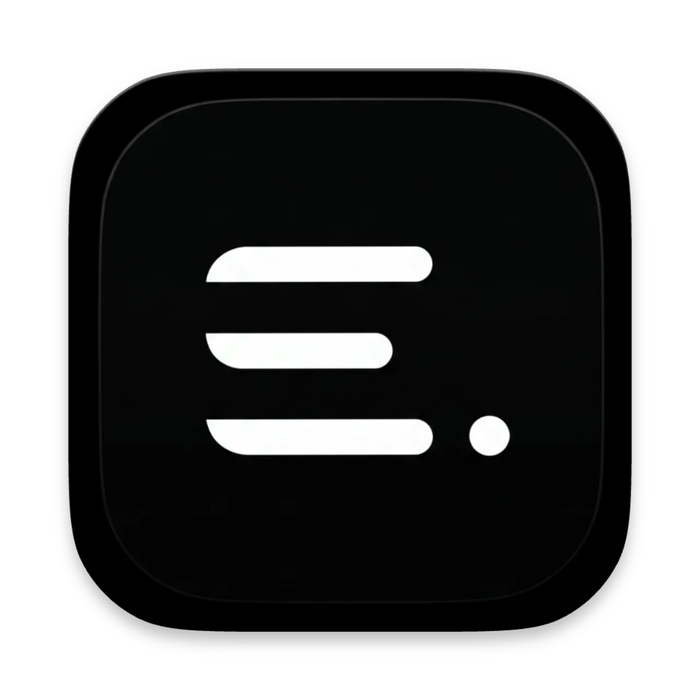
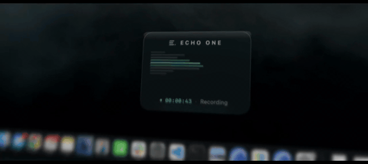

<div align="center">



# Echo One

Free, on-device dictation for Mac. Hold a key, talk, it types.<br>
Plus a voice for the Claude Code or Codex you already have.

<sub>The Voice Agent and Echo Actions arrive with 2.6. Today's download, 2.5.2, has dictation, meetings and instruction mode.</sub>

[](https://github.com/hg913488/ECHO_ONE/releases/latest/download/EchoOne.dmg)

```bash
brew install hg913488/tap/echo-one
```

[](https://github.com/hg913488/ECHO_ONE/releases/latest)
&nbsp;

&nbsp;

&nbsp;
[](LICENSE)

<br>



**[echooneapp.vercel.app](https://echooneapp.vercel.app)**

</div>

---

## Why Echo One

The good dictation apps cost a monthly subscription and send your voice to a server. Echo One does the same job for free, on your Mac, with nothing leaving it. It's built on [Ghost Pepper](https://github.com/matthartman/ghost-pepper), and it adds the thing none of them do: a voice for the coding agent you already pay for, so you can talk to Claude Code or Codex and hear it answer.

---

## What it does

**Dictation, anywhere.** Hold Right Command + Right Option, speak, let go. Echo One transcribes on your Mac and pastes into whatever has the cursor: Slack, Notion, email, Terminal. A small local model can tidy filler words as it goes. 25 languages with the default Parakeet model.

**Voice Agent.** Hold Right Command + Right Shift and ask your Mac to do something: "what's in my notes folder", "rename these screenshots by date", "summarise my ideas file". Echo One sends it to the Claude Code or Codex already signed in on your Mac, and answers out loud as it works. No new account and no API key: it uses the plan you already have. The Voice Agent ships in the app; its source isn't public.


**Echo Actions.** Some things shouldn't need an AI. Say "dark mode", "battery", "volume 30" or "timer 5 minutes" and a script runs straight away. Over 30 come built in, and you can add your own, one script file each. They use the same format as Raycast script commands, so Raycast scripts work too.


**Meetings.** Start a session before a call. When it ends you get a transcript with speakers labelled, notes, and a summary, saved as a Markdown file on your Mac.

**Instruction mode.** Hold Right Control and say what to do with the selected text: "translate to French", "make this formal", "turn this into bullet points". Nothing selected? It writes new text at the cursor.

**Lives in your menu bar.** No Dock icon and no window to manage. Every shortcut can be changed in Settings.

---

## Privacy

Dictation, cleanup, meetings and the Voice Agent's voice all run on your Mac. There's no analytics, no tracking SDK and no Echo One account.

| Feature | Where it runs |
|---|---|
| Speech-to-text | On your Mac: WhisperKit / FluidAudio |
| Text cleanup and instruction mode | On your Mac: Qwen via LLM.swift |
| Meeting transcripts and summaries | On your Mac, saved as Markdown |
| Voice Agent: your voice and its reply | On your Mac |
| Voice Agent: the text of your command | Your own Claude Code or Codex, under your own account |
| Echo Actions | Local scripts |
| Analytics and telemetry | None |

The internet is used for one-time model downloads from Hugging Face, the daily update check, and the Voice Agent's request to your own coding agent. The Voice Agent sends the files it reads in your chosen folder to that agent's provider, the same as using it in Terminal.

Don't take our word for it: point Claude at this repo and ask it to check. The prompt and the last result are in the [privacy audit](PRIVACY_AUDIT.md).

---

## Safety

The Voice Agent acts on your Mac from a few spoken words, and speech gets misheard. So it has guard rails.

- **Four access levels.** Ask only (reads and searches, changes nothing, the default), Edit files, Sandbox (works only inside its own folder) and Full.
- **It never deletes.** Anything it removes goes to the Trash, where Put Back restores it. For Claude Code, delete commands, force-pushes and hard resets are blocked outright, at every level.
- **It asks before anything leaves your Mac.** Sending, pushing, publishing or buying waits for you to say yes.
- **It never says a secret out loud.** Passwords and keys stay off the speaker.
- **Your own scripts ask first.** A new Echo Action asks before its first run, and again after you edit it. Actions that can't be undone, like Empty Trash, ask every time.
- **Stop it any time.** Say "stop", press Esc, or click the reply card.

---

## Install

1. [Download Echo One](https://github.com/hg913488/ECHO_ONE/releases/latest/download/EchoOne.dmg) and drag it to Applications, or run `brew install hg913488/tap/echo-one`.
2. Open it and allow what it asks for:
   - **Microphone**, to hear you.
   - **Accessibility** and **Input Monitoring**, for the shortcuts and to paste.
   - **Automation**, the first time an Echo Action controls another app (dark mode, quit an app).
3. Hold Right Command + Right Option and talk.

The Voice Agent needs [Claude Code](https://claude.com/product/claude-code) or [Codex](https://developers.openai.com/codex) installed and signed in. Dictation doesn't.

Apple Silicon (M1 or later) and macOS 14 or later. Signed with Developer ID and notarized by Apple. Updates arrive in the app.

---

## Echo Actions

An Echo Action is one script with a few comment lines on top:

```bash
#!/bin/bash
# @raycast.schemaVersion 1
# @raycast.title Open NHL Site
# @raycast.mode compact
# @echo.phrases open the nhl site, open my hockey site

open "https://example.com"
echo "Opened the NHL site."
```

Save it in `~/Documents/Echo One Actions/` and say its name. She says the last line it prints. A few of the built-ins:

| Say | Does |
|---|---|
| "dark mode", "light mode" | Switches the Mac's appearance |
| "volume 30", "mute" | Sets the sound |
| "battery", "disk space" | Tells you |
| "timer 5 minutes" | Rings when it's done |
| "kill port 3000" | Stops a stuck dev server |
| "quit Safari", "open Notes" | Quits or opens any app |

Want more? [ECHO-ACTIONS.md](ECHO-ACTIONS.md) explains the format for you or your agent, and [`actions/`](actions/) has every built-in to copy from. In the app, **Copy for Your Agent** puts the guide on your clipboard, ready to paste into Claude, ChatGPT or Codex.

---

## FAQ

**Is it really free?** Yes. No subscription, no trial, no account. If it helps you, you can [buy me a coffee](https://buymeacoffee.com/echoone).

**What's open source?** Dictation, meetings, instruction mode and Echo Actions, under the MIT licence. The Voice Agent ships in the app, but its source isn't public.

**Which Macs?** Apple Silicon (M1 or later) on macOS 14 or later.

**Do I need Claude or ChatGPT?** Only for the Voice Agent. Dictation, meetings and Echo Actions work without either.

**Does the Voice Agent cost extra?** No. It uses your existing Claude or ChatGPT plan through the Claude Code or Codex you already have signed in.

**Where are my files?** Meeting notes go to the folder you pick. Voice Agent transcripts are in `~/Documents/Echo One Agent/`. Your Echo Actions are in `~/Documents/Echo One Actions/`.

---

## Build from source

```bash
git clone https://github.com/hg913488/ECHO_ONE.git
open EchoOne.xcodeproj
# Cmd+R to build and run
```

More in [docs/development.md](docs/development.md). What changed in each version: [CHANGELOG.md](CHANGELOG.md).

---

## Credits

Echo One is a fork of [Ghost Pepper](https://github.com/matthartman/ghost-pepper) by Matt Hartman (MIT). Speech via [WhisperKit](https://github.com/argmaxinc/WhisperKit) and [FluidAudio](https://github.com/FluidInference/FluidAudio), text cleanup via [LLM.swift](https://github.com/eastriverlee/LLM.swift), updates via [Sparkle](https://sparkle-project.org/). The Echo Actions format comes from [Raycast script commands](https://github.com/raycast/script-commands). Licences for everything Echo One is built on are in [Acknowledgements](EchoOne/Acknowledgements.txt).

## Support

Echo One is made by one person. If you like it:

- [**Buy me a coffee**](https://buymeacoffee.com/echoone)
- **Star this repo**, so more people find it
- Share an Echo Action you made in [Discussions](https://github.com/hg913488/ECHO_ONE/discussions)
