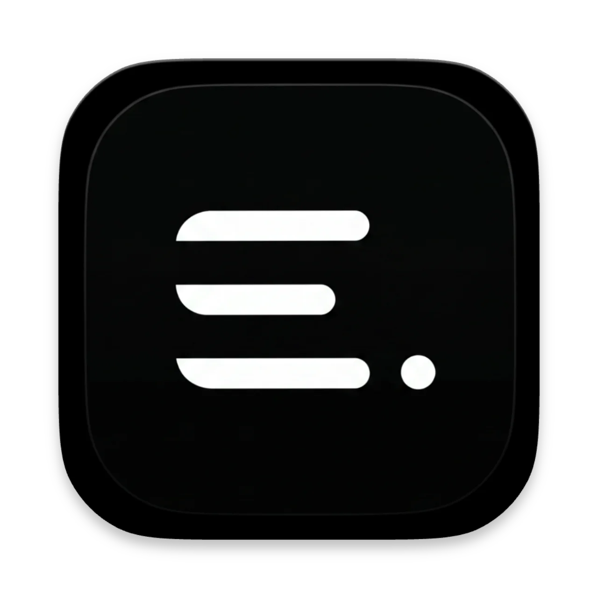
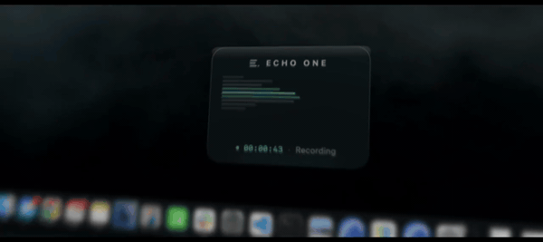
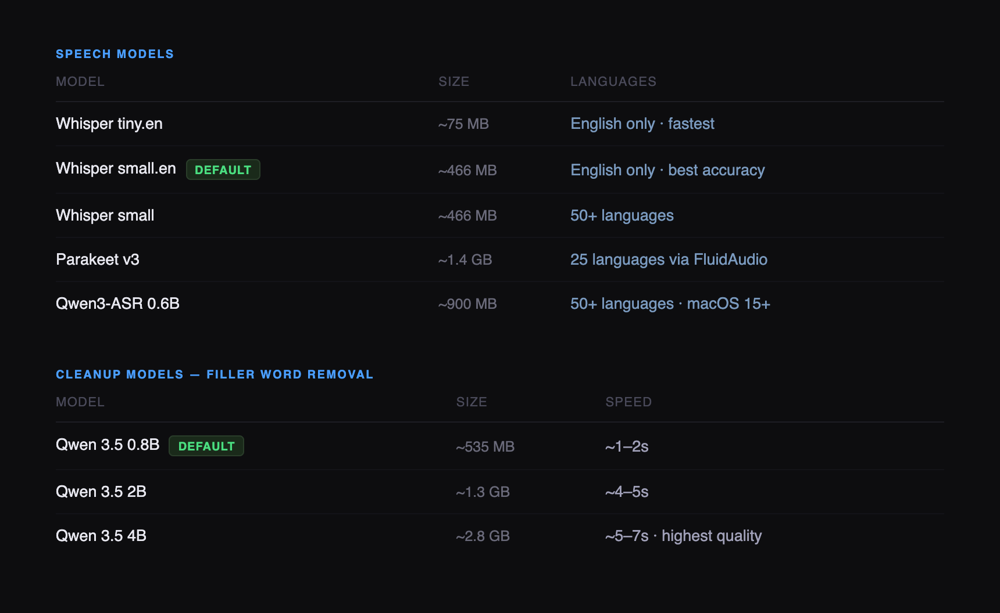

<div align="center">



# Echo One

Your voice, on your Mac, going nowhere else.

Hold **Command + Option** (the two keys right of the space bar), speak, release — transcribed and pasted directly into whatever you're typing in. Works in every app. No subscription, no cloud, no account.

macOS 14+ &nbsp;·&nbsp; Apple Silicon (M1+) &nbsp;·&nbsp; Free & open source

[](LICENSE)
&nbsp;

&nbsp;


<br>



<br>

**[→ echooneapp.vercel.app](https://echooneapp.vercel.app)**

</div>

---

## What it does

**Push-to-talk, anywhere** — hold Command + Option, speak, release. That is the default shortcut (Right ⌘ + Right ⌥); change it in Settings. Echo One transcribes and pastes directly into the focused text field. Slack, Notion, email, Terminal — anything with a cursor.

**Instruction mode** — hold Right Control and speak a command instead of dictation. Select text first and the instruction transforms it in place ("translate to French", "make this formal", "convert to bullet points"). No selection? New text is generated and pasted at the cursor.

**Meeting transcription** — start a session before a call. When you stop you get a full transcript, speaker-labeled notes, and an AI summary saved as a markdown file on your Mac.

**Lives in your menu bar** — no dock icon, no window to manage. Launches at login, gets out of your way.

---

## Everything stays on your machine

Speech recognition runs via [WhisperKit](https://github.com/argmaxinc/WhisperKit) on Apple Silicon. Text cleanup and instruction processing run through a local LLM. Nothing touches the internet except one-time model downloads from Hugging Face.

| Feature | Where it runs |
|---|---|
| Speech-to-text | On-device — WhisperKit / FluidAudio |
| Text cleanup | On-device — Qwen via LLM.swift |
| Instruction mode | On-device LLM |
| Audio recording | Local — AVAudioEngine, no streaming |
| Meeting transcription | Local — markdown saved to disk |
| Meeting summaries | On-device LLM |
| Analytics / telemetry | None — no Firebase, Mixpanel, Sentry, or any SDK |

Two optional features use cloud services when you configure them: **Google Calendar integration** fetches event data from googleapis.com when signed in, and **Context Bundler / Zo AI** sends voice commands and screen context to a third-party AI service. Both are off by default and require your own API keys. Everything else above is local-only.

Don't trust me — point Claude at this repo and ask it to audit: [full privacy audit](PRIVACY_AUDIT.md).

---

## Build & run

```bash
git clone https://github.com/hg913488/echo-one.git
open EchoOne.xcodeproj
# Cmd+R to build and run
```

Two permissions required: **Microphone** (to hear you) and **Accessibility** (to paste into other apps).

> **First launch on macOS Sequoia:** you may see "Apple could not verify this app". Go to **System Settings → Privacy & Security**, scroll down, click **Open Anyway**. One-time only.

---

## Models

Downloaded automatically on first use, cached locally. Pick yours in Settings.



Speech via [WhisperKit](https://github.com/argmaxinc/WhisperKit) and [FluidAudio](https://github.com/FluidInference/FluidAudio). Text cleanup and instruction mode via [LLM.swift](https://github.com/eastriverlee/LLM.swift). Updates via [Sparkle](https://sparkle-project.org/). MIT licensed.
