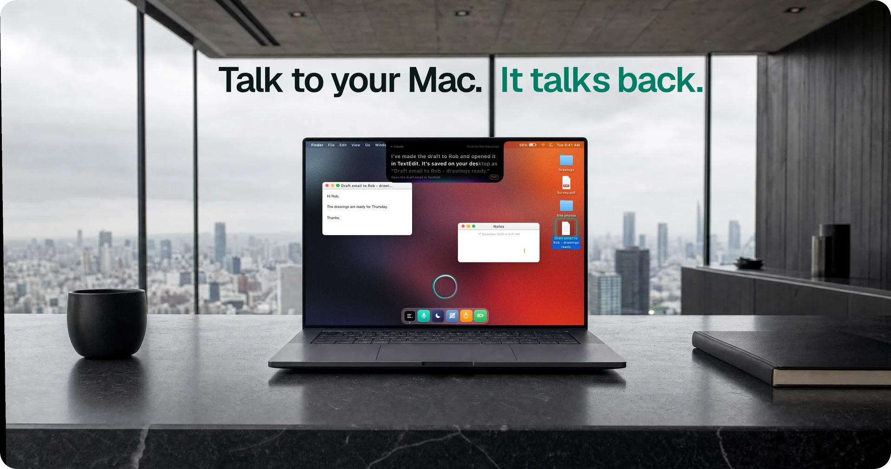
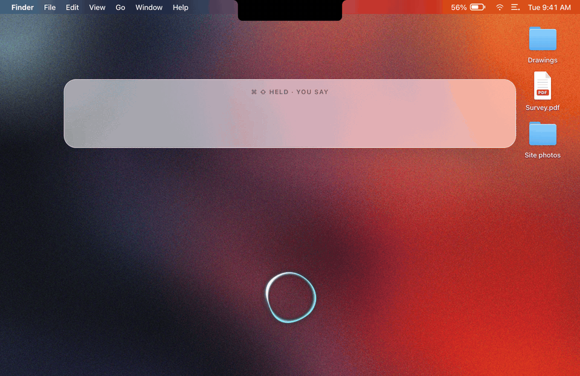
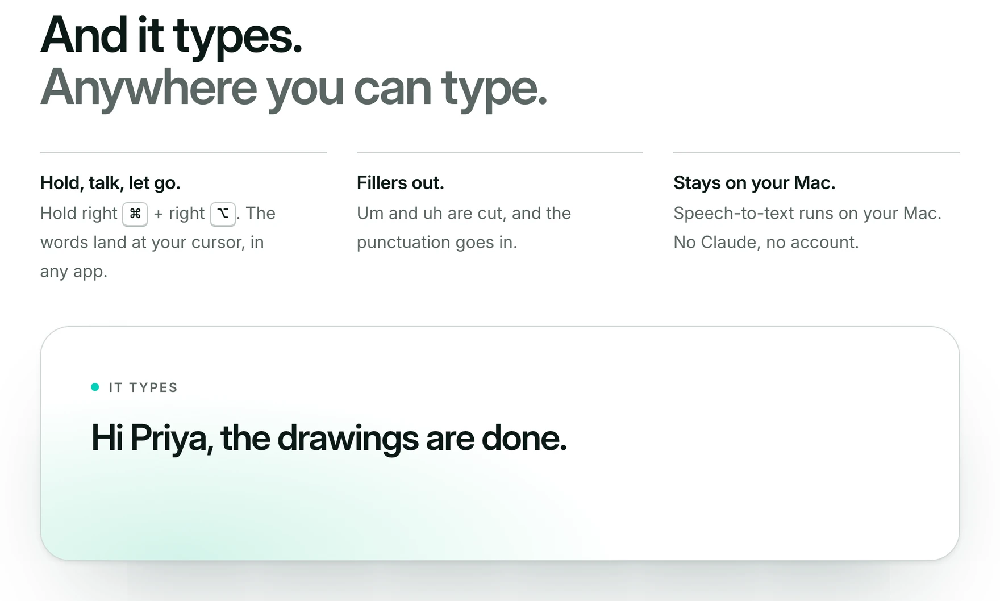
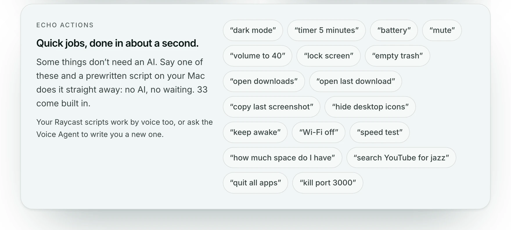
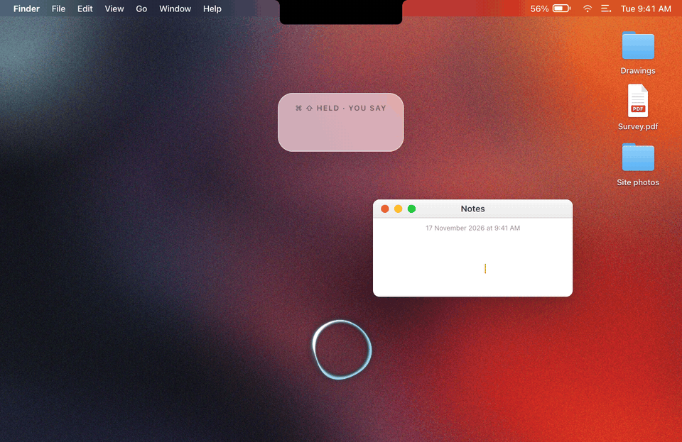
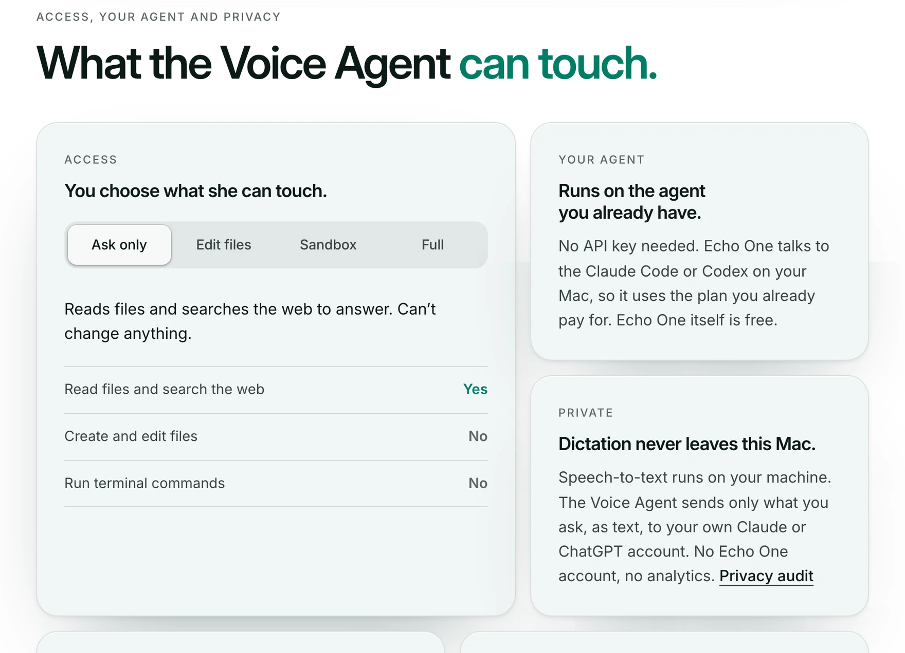
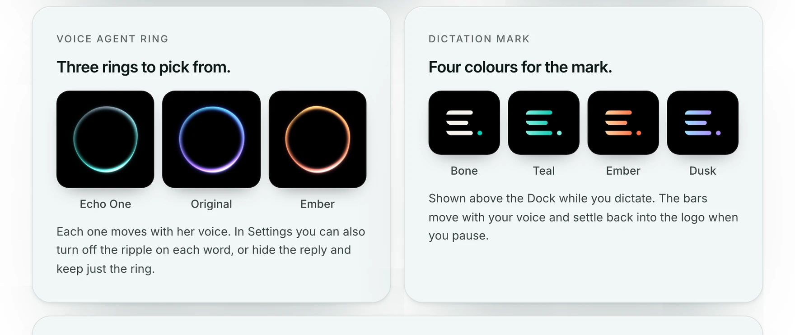
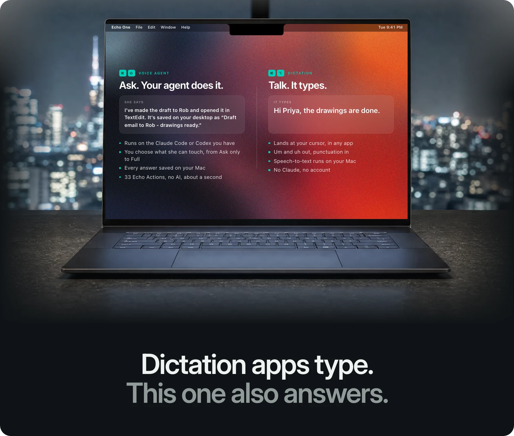

<a href="https://echooneapp.vercel.app"><picture><source media="(max-width: 600px)" srcset="./docs/media/readme/hero-sm.webp"></picture></a>

<div align="center">

<br>

**Echo One** is free, on-device dictation for Mac. Hold a key, talk, it types.<br>
Plus a voice for the Claude Code or Codex you already have.

<br>

<a href="https://github.com/hg913488/ECHO_ONE/releases/latest/download/EchoOne.dmg"><picture><source media="(prefers-color-scheme: dark)" srcset="https://img.shields.io/badge/Download_for_Mac-f2f5f4?style=for-the-badge&logo=apple&logoColor=101417"></picture></a>

```bash
brew install hg913488/tap/echo-one
```

<br>

[](https://github.com/hg913488/ECHO_ONE/releases/latest)
&nbsp;

&nbsp;

&nbsp;
[](LICENSE)

</div>

<br>

## Hold two keys. Ask. Hear it answer.

Hold **Right Command + Right Shift** and ask your Mac to do something: *"draft an email to Rob and put it on my desktop"*, *"what's in my notes folder"*, *"rename these screenshots by date"*. Echo One hands it to the Claude Code or Codex already signed in on your Mac, and answers out loud while it works.

No new account and no API key. It runs on the plan you already pay for.



<sub>The Voice Agent ships in the app. Its source isn't public.</sub>

<br><br>

<picture>
  <source media="(max-width: 600px) and (prefers-color-scheme: dark)" srcset="./docs/media/readme/dictation-dark-sm.webp">
  <source media="(max-width: 600px)" srcset="./docs/media/readme/dictation-light-sm.webp">
  <source media="(prefers-color-scheme: dark)" srcset="./docs/media/readme/dictation-dark.webp">
  
</picture>

Slack, Notion, Mail, Terminal: wherever the cursor is. 25 languages with the default Parakeet model, and a small local model can tidy the text as it goes.

<br>

<picture>
  <source media="(max-width: 600px) and (prefers-color-scheme: dark)" srcset="./docs/media/readme/actions-dark-sm.webp">
  <source media="(max-width: 600px)" srcset="./docs/media/readme/actions-light-sm.webp">
  <source media="(prefers-color-scheme: dark)" srcset="./docs/media/readme/actions-dark.webp">
  
</picture>



Add your own, one script file each. They use the same format as Raycast script commands, so your Raycast scripts work by voice too. [How to write one ↓](#write-an-echo-action)

<br>

<picture>
  <source media="(max-width: 600px) and (prefers-color-scheme: dark)" srcset="./docs/media/readme/touch-dark-sm.webp">
  <source media="(max-width: 600px)" srcset="./docs/media/readme/touch-light-sm.webp">
  <source media="(prefers-color-scheme: dark)" srcset="./docs/media/readme/touch-dark.webp">
  
</picture>

It acts on your Mac from a few spoken words, and speech gets misheard. So it has guard rails:

- **It's told never to delete.** Anything it removes should go to the Trash, where Put Back restores it. For Claude Code, delete commands, force-pushes and hard resets are blocked outright, at every level.
- **It's told to ask before anything leaves your Mac.** Sending, pushing, publishing or buying should wait for you to say yes.
- **It's told never to say a secret out loud.** Passwords and keys should stay off the speaker.
- **AI can still get things wrong.** These rules lower the risk; they don't remove it. Check its work and keep backups.
- **Your own scripts ask first.** A new Echo Action asks before its first run, and again after you edit it.
- **Stop it any time.** Say "stop", press Esc, or click the reply card.

<br>

<picture>
  <source media="(max-width: 600px) and (prefers-color-scheme: dark)" srcset="./docs/media/readme/looks-dark-sm.webp">
  <source media="(max-width: 600px)" srcset="./docs/media/readme/looks-light-sm.webp">
  <source media="(prefers-color-scheme: dark)" srcset="./docs/media/readme/looks-dark.webp">
  
</picture>

<br>

## Also in the box

**Meetings.** Start a session before a call. When it ends you get a transcript with speakers labelled, notes and a summary, saved as Markdown on your Mac.

**Instruction mode.** Hold Right Control and say what to do with the selected text: *"translate to French"*, *"make this formal"*, *"turn this into bullet points"*. Nothing selected? It writes new text at the cursor.

**Lives in your menu bar.** No Dock icon and no window to manage. Every shortcut can be changed in Settings.

<br>

## Privacy

Dictation, cleanup, meetings and the Voice Agent's voice all run on your Mac. No analytics, no tracking SDK, no Echo One account.

| | Where it runs |
|---|---|
| Speech-to-text | Your Mac (WhisperKit / FluidAudio) |
| Text cleanup and instruction mode | Your Mac (Qwen via LLM.swift) |
| Meeting transcripts and summaries | Your Mac, saved as Markdown |
| Voice Agent: your voice and its reply | Your Mac |
| Voice Agent: the text of your command | Your own Claude Code or Codex, under your own account |
| Echo Actions | Local scripts |
| Analytics and telemetry | None |

The internet is used for one-time model downloads from Hugging Face, the daily update check, and the Voice Agent's request to your own coding agent. The Voice Agent sends the files it reads in your chosen folder to that agent's provider, the same as using it in Terminal.

Don't take our word for it: point Claude at this repo and ask it to check. The prompt and the last result are in the [privacy audit](PRIVACY_AUDIT.md).

<br>

## Install

1. [Download Echo One](https://github.com/hg913488/ECHO_ONE/releases/latest/download/EchoOne.dmg) and drag it to Applications, or run `brew install hg913488/tap/echo-one`.
2. Open it and allow what it asks for:
   - **Microphone**, to hear you.
   - **Accessibility** and **Input Monitoring**, for the shortcuts and to paste.
   - **Automation**, the first time an Echo Action controls another app.
3. Hold Right Command + Right Option and talk.

The Voice Agent needs [Claude Code](https://claude.com/product/claude-code) or [Codex](https://developers.openai.com/codex) installed and signed in. Dictation doesn't.

Apple Silicon (M1 or later), macOS 14 or later. Signed with Developer ID and notarized by Apple. Updates arrive in the app.

<br>

## Write an Echo Action

One script with a few comment lines on top:

```bash
#!/bin/bash
# @raycast.schemaVersion 1
# @raycast.title Open NHL Site
# @raycast.mode compact
# @echo.phrases open the nhl site, open my hockey site

open "https://example.com"
echo "Opened the NHL site."
```

Save it in `~/Documents/Echo One Actions/` and say its name. She says the last line it prints.

[ECHO-ACTIONS.md](ECHO-ACTIONS.md) explains the format for you or your agent, and [`actions/`](actions/) has every built-in to copy from. In the app, **Copy for Your Agent** puts the guide on your clipboard, ready to paste into Claude, ChatGPT or Codex.

<br>

## FAQ

<details>
<summary><b>Is it really free?</b></summary>
<br>
Yes. No subscription, no trial, no account. If it helps you, you can <a href="https://buymeacoffee.com/echoone">buy me a coffee</a>.
<br><br>
</details>

<details>
<summary><b>What's open source?</b></summary>
<br>
Dictation, meetings, instruction mode and Echo Actions, under the MIT licence. The Voice Agent ships in the app, but its source isn't public. The public code can lag behind the released app: right now it builds 2.5.2 dictation, with the 2.6 Echo Actions runner in `EchoOne/Agent/EchoActions.swift`.
<br><br>
</details>

<details>
<summary><b>Do I need Claude or ChatGPT?</b></summary>
<br>
Only for the Voice Agent. Dictation, meetings and Echo Actions work without either.
<br><br>
</details>

<details>
<summary><b>Does the Voice Agent cost extra?</b></summary>
<br>
No. It uses your existing Claude or ChatGPT plan through the Claude Code or Codex you already have signed in.
<br><br>
</details>

<details>
<summary><b>Which Macs?</b></summary>
<br>
Apple Silicon (M1 or later) on macOS 14 or later.
<br><br>
</details>

<details>
<summary><b>Where are my files?</b></summary>
<br>
Meeting notes go to the folder you pick. Voice Agent transcripts are in <code>~/Documents/Echo One Agent/</code>. Your Echo Actions are in <code>~/Documents/Echo One Actions/</code>.
<br><br>
</details>

<br>

## Build from source

```bash
git clone https://github.com/hg913488/ECHO_ONE.git
open EchoOne.xcodeproj
# Cmd+R to build and run
```

More in [docs/development.md](docs/development.md). What changed in each version: [CHANGELOG.md](CHANGELOG.md).

<br>

## Disclaimer

Echo One is free and comes as is, with no warranty. The Voice Agent acts on your Mac through your own Claude Code or Codex, and AI can get things wrong: you're in charge of what you ask it to do, so check its work and keep backups. Echo One isn't affiliated with Anthropic, OpenAI or Raycast. The full [terms of use](https://echooneapp.vercel.app/terms/).

<br>

## Credits

Echo One is a fork of [Ghost Pepper](https://github.com/matthartman/ghost-pepper) by Matt Hartman (MIT). Speech via [WhisperKit](https://github.com/argmaxinc/WhisperKit) and [FluidAudio](https://github.com/FluidInference/FluidAudio), text cleanup via [LLM.swift](https://github.com/eastriverlee/LLM.swift), updates via [Sparkle](https://sparkle-project.org/). The Echo Actions format comes from [Raycast script commands](https://github.com/raycast/script-commands). Licences for everything Echo One is built on are in [Acknowledgements](EchoOne/Acknowledgements.txt).

<br>

<a href="https://github.com/hg913488/ECHO_ONE/releases/latest/download/EchoOne.dmg"></a>

<div align="center">

<br>

<a href="https://github.com/hg913488/ECHO_ONE/releases/latest/download/EchoOne.dmg"><picture><source media="(prefers-color-scheme: dark)" srcset="https://img.shields.io/badge/Download_for_Mac-f2f5f4?style=for-the-badge&logo=apple&logoColor=101417"></picture></a>

Made by one person. If you like it, [buy me a coffee](https://buymeacoffee.com/echoone), star the repo so more people find it,<br>or share an Echo Action you made in [Discussions](https://github.com/hg913488/ECHO_ONE/discussions).

**[echooneapp.vercel.app](https://echooneapp.vercel.app)**

</div>
